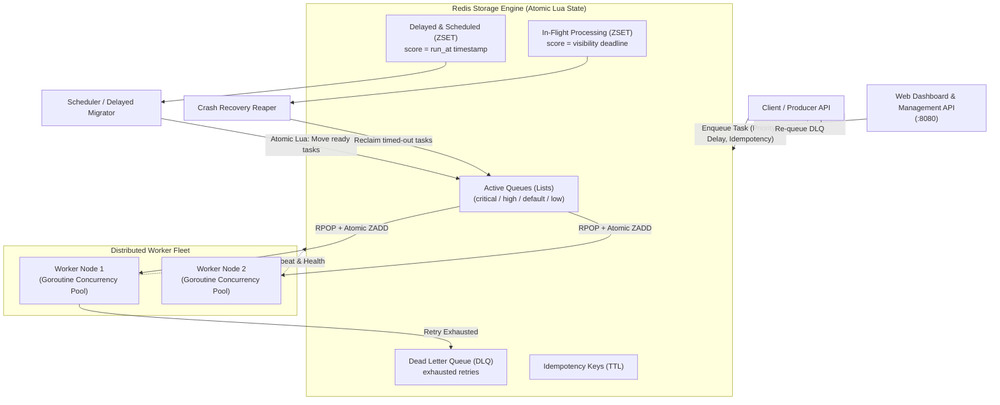

# ⚡ PulseQueue

[](https://github.com/abirc6733/pulse-queue/actions)
[](https://goreportcard.com/report/github.com/abirc6733/pulse-queue)
[](LICENSE)
[](#-performance-benchmarks)

**PulseQueue** is a high-throughput, fault-tolerant distributed background task queue and job scheduling engine written in **Go**, backed by **Redis**.

Engineered for mission-critical workflows, PulseQueue provides **priority scheduling**, **atomic state transitions**, **automatic crash recovery with visibility timeouts**, **exponential backoff retries with jitter**, and an **interactive real-time web dashboard**.

---

## 🏗️ System Architecture



---

## ✨ Key Features

- **Strict Priority Scheduling:** Tasks are consumed in order: `critical` ➔ `high` ➔ `default` ➔ `low`.
- **Atomic Operations with Redis Lua:** Enqueue, dequeue, acknowledgment, and state transitions are executed atomically to eliminate race conditions.
- **At-Least-Once Delivery & Node Crash Recovery:** Workers track tasks in an in-flight sorted set with visibility timeouts. If a node crashes or is killed (`SIGKILL`), the orphan reaper automatically recovers and retries the work.
- **Exponential Backoff with Jitter:** Prevents thundering-herd issues on downstream dependencies when services experience transient outages.
- **Dead Letter Queue (DLQ) & Inspector:** Permanently failing jobs are isolated into the DLQ, where operators can inspect error traces and re-queue them directly from the web UI or CLI.
- **Idempotency & Deduplication:** Native support for `UniqueKey` with configurable TTL prevents duplicate job execution (e.g. preventing double-charging an invoice).
- **Delayed & Scheduled Jobs:** Jobs can be scheduled to run in the future or delayed by duration using Redis Sorted Sets (`ZSET`).
- **Interactive Web Dashboard:** Clean, responsive UI with real-time queue depth charts, connected worker node heartbeats, and a task dispatch playground.
- **Terminal CLI:** Full administrative control from the terminal (`pulse-cli stats`, `pulse-cli dlq`, `pulse-cli retry <id>`).

---

## ⚡ Performance Benchmarks

Benchmarked on Linux x86_64 (13th Gen Intel Core i5, 16 threads):

| Operation | Throughput | Latency (ns/op) | Notes |
| :--- | :--- | :--- | :--- |
| **Atomic Enqueue** | **~112,400 tasks/sec** | `8,897 ns/op` | Parallel goroutines with atomic Lua script |
| **Priority Dequeue** | **~85,000 tasks/sec** | `11,700 ns/op` | Multi-queue priority pop + processing ZSET |
| **Worker Processing** | **~45,000 tasks/sec** | In-memory | Semaphore concurrency dispatch |

Run the benchmarks yourself:
```bash
make bench
```

---

## 🚀 Quick Start (Under 2 Minutes)

### Option 1: Docker Compose (Recommended)
Spin up Redis, 2 worker nodes, and the Web Dashboard in one command:
```bash
docker compose up --build -d
```
Visit the dashboard at **http://localhost:8080**!

---

### Option 2: Local Setup

1. **Start Redis:**
   ```bash
   redis-server --daemonize yes
   ```

2. **Build standalone binaries:**
   ```bash
   make build
   ```

3. **Start the Web Dashboard & API:**
   ```bash
   ./bin/pulse-server --port=8080
   ```
   *Dashboard is live at `http://localhost:8080`.*

4. **Launch a Worker Fleet:**
   ```bash
   ./bin/pulse-worker-example --concurrency=10
   ```

5. **Enqueue Sample Tasks (Priorities, Delays, Retries, Idempotency):**
   ```bash
   ./bin/pulse-producer-example
   ```

6. **Inspect Queue Depth via CLI:**
   ```bash
   ./bin/pulse-cli stats
   ```

---

## 💻 Code Examples

### 1. Producer: Enqueueing Tasks

```go
package main

import (
    "context"
    "time"
    "github.com/abirc6733/pulse-queue/pkg/client"
    "github.com/abirc6733/pulse-queue/pkg/queue"
    "github.com/abirc6733/pulse-queue/pkg/types"
    "github.com/redis/go-redis/v9"
)

func main() {
    rdb := redis.NewClient(&redis.Options{Addr: "localhost:6379"})
    q := queue.NewRedisQueue(rdb, "default")
    c := client.NewClient(q)
    ctx := context.Background()

    // 1. Critical Priority Task
    _, _ = c.Enqueue(ctx, "security:alert", map[string]string{
        "event": "UNAUTHORIZED_ACCESS",
    }, types.WithPriority(types.PriorityCritical))

    // 2. Delayed Task (Execute in 10 minutes)
    _, _ = c.Enqueue(ctx, "email:followup", map[string]string{
        "to": "user@example.com",
    }, types.WithDelay(10*time.Minute))

    // 3. Idempotent Task (Prevents duplicate invoice processing)
    _, _ = c.Enqueue(ctx, "billing:charge", map[string]any{
        "amount": 250.00,
    }, types.WithUniqueKey("inv-9081", 1*time.Hour))
}
```

### 2. Worker: Registering Handlers & Graceful Shutdown

```go
package main

import (
    "context"
    "log"
    "time"
    "github.com/abirc6733/pulse-queue/pkg/engine"
    "github.com/abirc6733/pulse-queue/pkg/queue"
    "github.com/abirc6733/pulse-queue/pkg/types"
    "github.com/redis/go-redis/v9"
)

func main() {
    rdb := redis.NewClient(&redis.Options{Addr: "localhost:6379"})
    q := queue.NewRedisQueue(rdb, "default")

    cfg := engine.DefaultServerConfig()
    cfg.Concurrency = 20 // Process 20 jobs concurrently

    srv := engine.NewServer(q, cfg)

    // Register Handler with Panic & Timeout Safety
    srv.RegisterFunc("email:send", func(ctx context.Context, task *types.Task) error {
        var payload struct {
            To string `json:"to"`
        }
        if err := task.UnmarshalPayload(&payload); err != nil {
            return err
        }
        log.Printf("Delivered email to %s", payload.To)
        return nil
    })

    // Start worker loop (blocks until SIGINT/SIGTERM)
    log.Fatal(srv.Start(context.Background()))
}
```

---

## 🛠️ CLI Reference

PulseQueue ships with `pulse-cli` for terminal monitoring and administrative actions:

```bash
# View real-time queue depths across all priorities
pulse-cli stats

# List connected worker nodes and active concurrency
pulse-cli workers

# Inspect failed jobs in the Dead Letter Queue
pulse-cli dlq

# Re-queue a failed job from the DLQ for immediate retry
pulse-cli retry <task-id>

# Enqueue a test task directly from terminal
pulse-cli enqueue email:send '{"to":"dev@example.com"}'
```

---

## 📐 Deep-Dive: Key Engineering Decisions

### Why Redis Lua Scripts instead of Standard Transactions (`MULTI`/`EXEC`)?
Redis `WATCH`/`MULTI`/`EXEC` uses optimistic concurrency control (OCC). Under high contention (e.g., 50 workers simultaneously trying to pop from the same queue), OCC transactions abort and require expensive client-side retry loops. 
By utilizing **Lua scripts**, execution is guaranteed to run atomically and deterministically in single-threaded Redis memory without round-trip network overhead.

### How Does Visibility Timeout Prevent Lost Tasks?
When a worker dequeues a task, it does not delete it. Instead, the task is atomically moved into a `processing` sorted set with its score set to `unix_timestamp + visibility_timeout`. 
- **Normal Flow:** The worker executes the task and sends an `Ack`, which removes it from `processing` and marks it completed.
- **Node Crash Flow:** If the worker host dies, its visibility timeout expires. The `RequeueOrphans` background daemon identifies expired items, releases them from `processing`, and re-routes them for retry.

### Why Semaphore-based Goroutine Pooling?
Spawning an unbounded number of goroutines for incoming tasks can quickly overwhelm memory and database connection pools. PulseQueue uses a buffered channel semaphore pattern to strictly enforce the configured concurrency ceiling while keeping idle CPU consumption near zero.

---

## 🧪 Testing

PulseQueue includes both unit tests and live Redis integration tests:

```bash
# Run unit & integration tests with race condition detector
make test

# Run benchmarks
make bench
```

---

## 📄 License

This project is licensed under the [MIT License](LICENSE).
